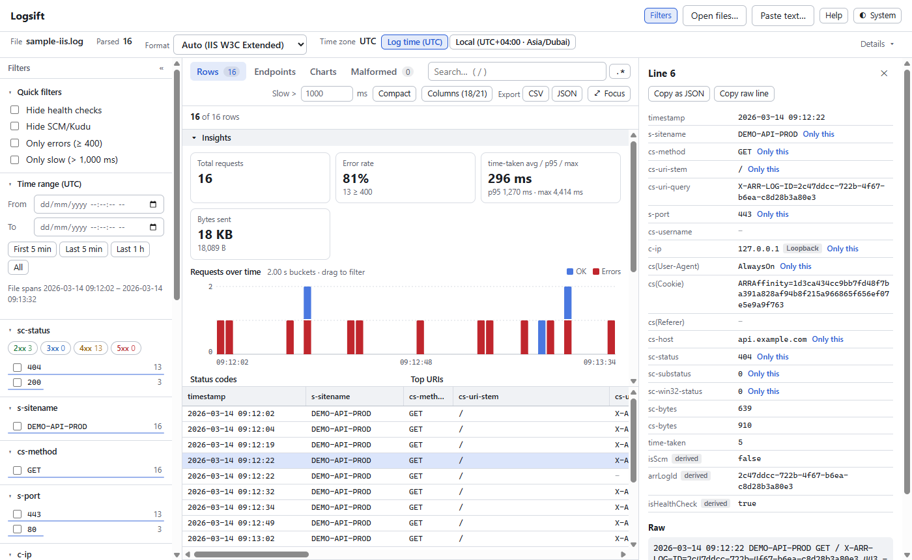

# Logsift

Sift through your logs in the browser. Logsift is a client-side web app for exploring IIS W3C logs and failed
request traces, Windows Event Log exports, Apache/Nginx, Serilog, Python, Java (logback, log4j, Spring Boot), JSON
(including pino and Docker), logfmt, syslog, CSV and plain-text log files — and any other layout you describe with a
custom pattern.

**Open it: https://logsift.ayzo.app/** — no install or sign-up. It can also be installed as an app that works offline.
What changed in each release: [CHANGELOG.md](CHANGELOG.md) (also under *What's new* in the app's Help).



**What you can do with it**

- **Find what broke**: the **Compare** tab puts two time ranges side by side (before and after a deploy, the last
  hour against the one before): endpoints with more errors or slower responses, new error messages, new status codes.
- **Watch logs live**: **Open folder…** shows new lines as your app writes them, like `tail -f` with filters, charts
  and error counts.
- **Read your kind of log**: 15+ formats are detected automatically, and **Custom pattern…** reads any other layout.
- **Dig in and share**: filters and search on a table that stays fast at 500k rows; Endpoints, Patterns and Charts
  views; copy findings as Markdown for a ticket or a pull request.

**Try it without your own logs**: on the start page, **More samples** opens a demo of an API whose payments start
failing (it opens in Compare), a live demo that keeps writing lines, and one small log of each supported kind. The
demo logs are generated in the browser.

Everything runs in your browser: files are parsed in a Web Worker and **no data leaves the machine**
(there is no backend and no network call besides loading the app itself).

## Running

Requires Node 20+ (developed on Node 24).

```sh
npm install
npm run dev          # dev server at http://localhost:5173
npm run build        # type-check + production build into dist/
npm run preview      # serve the production build
npm test             # unit + UI integration tests (Vitest)
npm run typecheck    # TypeScript, strict mode
npm run test:perf    # 500k-line parse benchmark (logs timings)
npm run gen:iis -- 500000 big.log   # write a synthetic IIS log to try in the UI
```

### Windows: double-click launcher

**`Logsift.cmd`** (in the project folder) starts the app locally and opens it in your browser. Requires Node.js 20+.

- **First run:** installs dependencies (`npm ci`) and builds the app, which takes about a minute.
- **Later runs:** start in a few seconds. The app is rebuilt automatically when the code changed since the last
  build (a different git commit, e.g. after `git pull`); run `Logsift.cmd rebuild` to force a rebuild after
  local edits.
- **Already running?** Double-clicking again just opens the browser at http://localhost:4173/.
- **To stop:** close the console window.
- **Shortcut:** right-click `Logsift.cmd` → *Send to* → *Desktop (create shortcut)* for a desktop icon.

It serves the production build (`vite preview`) on localhost only, so other machines can't reach it and logs never
leave your PC. Opening `dist\index.html` directly from disk does not work, because browsers block the parser's
worker on `file://` pages; that's why the launcher runs a small local server.

### Install as an app

In Chrome or Edge, open the site (or the launcher's page) and click the install icon in the address bar (or
menu → *Install Logsift*). The installed app opens in its own window, works **offline** once it has been opened
once, and on Windows appears under *Open with* for `.log`, `.txt`, `.json`, `.xml`, `.csv`, `.gz` and `.zip` files.
A small service worker (`public/sw.js`, production builds only) keeps the app's own files for offline use; it
never sees log data, since files are read by the page itself. New versions load as soon as there is a connection.

Open the app, then drop one or more `.log`/`.txt`/`.json`/`.xml`/`.csv` files (or `.gz`/`.zip` archives of them) anywhere on the page,
use **Choose files…**, paste log text (**Paste text…**, or just press Ctrl+V anywhere outside a text field), or click
**Load sample data** (loads `fixtures/sample-iis.log`, bundled into the app).

### Live tail from Azure App Service, with no install: the Kudu bookmark

Every App Service has a Kudu site (`https://<app>.scm.azurewebsites.net`, in the portal under **Advanced Tools**),
which you can open with your normal portal sign-in. On the start page, **Azure App Service…** shows how to set it up:

1. Drag the **Logsift for Kudu** button to the browser's bookmarks bar (or, where bookmarks can't be added, copy its
   code and paste it into the browser console on the Kudu site).
2. Open the app's Kudu site and click the bookmark there. Logsift opens in a new tab.
3. Choose what to watch: **Application logs** (`LogFiles/Application`), **the app's own Logs folder**
   (`site/wwwroot/Logs`, e.g. Serilog's file sink), **web server (IIS) logs** (`LogFiles/http/RawLogs`), all of
   `LogFiles`, or another folder. The newest files open (up to 10 files and 64 MB, since they come over the network),
   then new lines arrive live, like a local folder. Keep the Kudu tab open while you watch.

How it works: the bookmark runs in the Kudu tab, where you are signed in, and opens Logsift. Logsift asks it by
`postMessage` to list folders and read parts of files; it does that with Kudu's VFS API (`GET /api/vfs/…`, with a
`Range` header for the new bytes) and answers. Nothing goes anywhere but between the two tabs. The bookmark only
answers the Logsift tab it opened and only does GET requests, refusing paths with `..`; Logsift only accepts its
messages from the window that opened it, and only from an `https://….scm.azurewebsites.net` origin. Folder listings
are cached for 2 s, so a check doesn't list every folder each second. If Kudu ignores `Range`, each read downloads
the whole file (fine for small logs).

Security:

- **Log files only.** The bookmark itself only reads log file types (`.log .txt .csv .tsv .json .jsonl .ndjson .clef
  .xml .gz .zip`) under `LogFiles/` or in a folder with "log" in its name, and never files named like settings or
  secrets (`appsettings*`, `web.config`, `*.config`, `.env`, `secret`, `password`, `connectionstring`,
  `credential`). Since the rule is in the bookmark, even a compromised Logsift page could not read the app's
  settings. Logsift applies the same rule (`isKuduLogPath`) and doesn't show other files.
- **The bookmark trusts the address it was made from**, which is fixed into it. Create it from
  `https://logsift.ayzo.app`; one made from a local copy (`localhost`) talks to whatever runs there later (the setup
  dialog warns about this).
- **The console option** (pasting the code into the browser console on the Kudu site) does the same, but only paste
  code copied from Logsift's own dialog, never code someone sends you.
- **Your logs stay in your browser**, but production logs can contain personal data or tokens: check your company's
  policy on viewing them in a tool like this (or host your own copy of Logsift).

### Live tail from Azure App Service, kubectl, docker or ssh: the `logsift` launcher

Log streams that are not files (Azure App Service, Kubernetes, Docker, a Linux server over SSH) can't be read by a
web page, so a small launcher does it. It is **not on npm yet**; run it from a clone of this repository (Node.js 18+):

```sh
npm ci && npm run build:cli                              # once: builds the app into cli/app
node cli/bin/logsift.mjs --azure my-api -g my-resource-group   # runs "az webapp log tail" for you
kubectl logs -f deploy/api | node cli/bin/logsift.mjs          # or pipe in any command
docker logs -f api 2>&1 | node cli/bin/logsift.mjs
ssh my-vm "tail -F /var/log/app.log" | node cli/bin/logsift.mjs
```

Once it is published to npm, `node cli/bin/logsift.mjs` becomes `npx logsift` on any machine.

It opens Logsift in your browser with the stream live: the live bar, Follow, filters and Compare work as for a
folder. For App Service it needs the [Azure CLI](https://aka.ms/installazurecli) signed in (`az login`) and logging
turned on for the app (`az webapp log config -n my-api -g my-resource-group --application-logging filesystem
--web-server-logging filesystem`). Options: `--slot`, `--subscription`, `--name <label>`, `--port <n>`,
`--no-open`. On Windows PowerShell 5.1 prefer `--azure` to piping `az` into it (PowerShell 5.1 re-encodes text
between commands).

How it works: the launcher (`cli/`, no dependencies) serves the built app and the stream on `127.0.0.1` only. The
stream needs a random token that is only in the address it opens, and requests for any other host name are refused,
so other machines and web sites can't read it. It keeps the newest 256 MB for a page that reloads. The app sees
`?stream=/stream?token=…` (only on 127.0.0.1/localhost, only that same-origin path) and reads the stream as a file
that keeps growing, through the same live tail as a folder. When the command ends, the live bar says so and the rows
stay.

To publish the npm package (not done yet): `npm run build:cli` (builds the app, copies it into `cli/app/` and gives
the package the app's version), then `cd cli && npm publish` with an npm account.

### Live tail: watch a folder

In Chrome and Edge, **Open folder…** (or dropping a folder on the page) opens the log files in a folder and its
sub-folders (3 levels; hidden folders and `node_modules` skipped) and keeps watching it, like `tail -f`:

- **What opens**: the most recently changed non-empty log files, up to 50 files and 512 MB (the newest file always
  opens); the live bar says when older files were left out, and those stay out (only files that appear later are
  added). The files are copied into memory when opened, because Chrome can't read a file snapshot again once the file
  has changed: a busy log can't break the parse, or a later re-parse with another format. Rows from different files
  are merged by time (only the new rows are merged in) and get a **source file** column.
- **New lines and files**: every second the files are checked for bytes written since the last read, and the folder
  for new log files. While a file grows, only complete lines are read, each with its line number continuing the
  file's, and its last entry stays open, so a stack trace written a moment after its line still joins it. Once the
  file stops growing (a check finds it unchanged), the entry is closed, so the newest entry shows up one check after
  it was written. A last line without a newline waits until the file has been quiet for 10 s: an editor (with
  auto-save) or a slow writer may still be in the middle of it, and reading it early would split the line in two. Each file keeps its own parser state (CSV
  header, IIS `#Fields`). A file that got smaller (truncated or replaced by log rotation) is read again from the
  start; a deleted file is dropped. `.gz` and `.zip` files open once but aren't watched.
- **Live bar**: Live/Paused, what is watched, rows added and when; **Follow** keeps the newest row in view (scrolling
  up stops it, scrolling back to the end resumes it; it needs file order, so it is off while a column is sorted),
  **Pause** and **Stop** (the rows stay). Filters stay as they are and every view updates with the new rows; changing
  the format re-reads the files and keeps watching.
- **Remembered**: the folder's handle is kept in IndexedDB, so the start page offers **Reopen *folder*/** (the browser
  asks for permission again). In the installed app, files opened with *Open with → Logsift* are watched the same way.
- **Cost**: each update rebuilds the filter index, so big logs are checked less often (every 4× the last index build
  time, at least 1 s, at most 30 s): about every 4 s at 500k rows.
- Reading uses the File System Access API with read permission only; as everywhere in Logsift, nothing is uploaded.
  Firefox and Safari don't have it, so the button isn't shown there.

### Several files and archives

Select or drop several files at once — for example a day of hourly IIS logs — and they are parsed as one log:
files are read in natural name order (`u_ex26102709.log` before `u_ex26102710.log`), rows from overlapping files are
interleaved by timestamp, and a **source file** column (also a filter) says where each row came from. Line numbers
stay per file, and the row details and Malformed tab show the file name.

- **`.gz`** files are decompressed while streaming (`u_ex261027.log.gz` → `u_ex261027.log`).
- **`.zip`** archives are expanded: every `.log`/`.txt`/`.json`/`.jsonl`/`.ndjson`/`.clef`/`.xml`/`.csv`/`.tsv` entry is parsed
  (other files and folders, such as FREB's `freb.xsl`, are ignored). Zip a failed-request-tracing folder to open all
  its `fr*.xml` traces at once.
  Stored and deflated entries are supported; ZIP64 and password-protected archives are not.
- Decompression uses the browser's built-in `DecompressionStream`, so it adds no code and nothing is uploaded.
- Empty or unsupported files in a selection are skipped with a notice; the rest still open.

### Hosted version, CI and deployment

`.github/workflows/ci.yml` runs on every push and pull request: `npm ci`, type check, tests and production build
(Node 24). On `main`, a green build is then deployed to GitHub Pages, served at
**https://logsift.ayzo.app/** (custom domain; `anwarptr.github.io/Logsift/` redirects there). The site is static: files you open are still parsed only in your
browser. One-time setup: in the repository's **Settings → Pages → Build and deployment**, set **Source** to
**GitHub Actions** (until then the deploy job fails while the checks still run). The perf benchmark is not part
of CI (timings on shared runners are too noisy to gate on).

## Supported formats

The format is auto-detected from the first 50 non-blank lines; the **Format** dropdown in the file bar
re-parses the file with a forced format.

| Format | Detection | Notes |
| --- | --- | --- |
| **IIS W3C Extended** | any `#Software:` / `#Fields:` line | Columns come from `#Fields:`; a new `#Fields:` mid-file switches the schema from that line on. `#` lines go to the File Info metadata list. `-` → null. `date`+`time` → one UTC `timestamp`. Numeric fields (`s-port`, `sc-status`, `sc-substatus`, `sc-win32-status`, `sc-bytes`, `cs-bytes`, `time-taken`) become numbers. |
| **IIS failed request trace** (FREB, `fr*.xml`) | a `<failedRequest` line | One file is one failed request, so it becomes **one row**: `timestamp` (first event), `method`, `host`, `uri`, `query`, `status`/`subStatus` (`500.19` → 500 and 19), `timeTaken` (ms), `failureReason`, `level` (the most severe event), `module`/`notification` (who set the error status, and when), a `message` summing it up with the error code and any config error, `bytesSent`/`bytesReceived`, `userAgent`, `appPool`, `userName` and the event count. The row's raw text is the **event timeline** (time, ms since the first event, event name, warnings/errors flagged, data fields with IIS's descriptions in place of numeric codes), shown under "Event timeline" in the row details and searchable like any raw text. Each event is not its own row: a single request has hundreds, which would swamp the table and the endpoint counts. The XML is read with a small built-in reader (the browser's `DOMParser` is not available in workers). Other XML files (besides Windows event logs, below) are rejected with a clear message rather than parsed as text. |
| **Windows Event Log (XML)** | XML with `<Event>` elements | Event Viewer's "Save as XML", `wevtutil qe /f:xml` output, and Azure App Service's `LogFiles/eventlog.xml` (where the ASP.NET Core Module and .NET Runtime report startup crashes). One event is one row, whether events share a line or span several: `timestamp` (`TimeCreated`, UTC), `level` (1 Critical, 2 Error, 3 Warning, 4 Information, 5 Verbose; 0 shows as Information, as in Event Viewer; a rendered level wins), `provider`, `eventId`, `message` (the rendered message when the export has one, otherwise the event data: unnamed values as they are, named ones as `Name: value`), and, when present, `channel`, `computer`, `processId`, `recordId`. Critical and Error events count as errors. The raw text is the event's XML. |
| **Apache/Nginx combined** (and common) | ≥ 60% of lines match | Mapped to IIS-style column names (`c-ip`, `cs-method`, `cs-uri-stem`, `sc-status`, `sc-bytes`, …) so the same filters and insights apply. |
| **JSON lines** | ≥ 60% of lines are JSON objects | Columns are the union of keys; nested values are shown as JSON. `timestamp`/`@timestamp`/`time`/`ts`/`date` becomes the timestamp; `level`/`severity`, `message`/`msg`, `logger`/`source`, `status`, `path`/`url`, `durationMs` get semantic roles. Files may be `.json`, `.jsonl`, `.ndjson` or `.clef`. **Serilog JSON**: compact JSON (CLEF: `@t`, `@l`, `@mt`/`@m`, `@x`) becomes `level` (missing `@l` means Information), `message` (the template filled from the event's properties), `MessageTemplate`, `Exception`, `TraceId`/`SpanId`; the older `JsonFormatter`'s `Properties` are spread into their own columns and `RenderedMessage` is the message; `RequestPath`/`RequestMethod`/`StatusCode`/`Elapsed` from request logging get the URI/method/status/duration roles. **pino/bunyan**: numeric levels (10–60) become TRACE…FATAL, and nested `req`/`res` objects are flattened (`req.method`, `req.url`, `res.statusCode`; with `responseTime` they get the method/URI/status/duration roles). **Docker** json-file logs (`{"log":…,"stream":…,"time":…}`, also from `kubectl logs`): the container's output in `log` is the message, read like a text log (level, logger) or, when it is JSON, spread into columns; `stream` says stdout/stderr. Also recognised: `levelname` (python-json-logger), ECS's `log.level`/`url.path`/`http.response.status_code`, structlog's `event` as the message. |
| **logfmt** | ≥ 60% of lines are mostly `key=value` pairs (at least 3, starting with one) | Go (`log/slog` TextHandler, logrus, go-kit), Heroku, Loki. Values may be quoted (`msg="a b"`, `\"` escapes); a bare key is `true`. `time`/`ts`/`t` is the timestamp; `level`, `msg`, `path`, `status`, `method`, `ip` etc. get roles as in JSON. Go durations (`12ms`, `1.5s`, `1m2s`) become milliseconds (the column is labelled `duration (ms)`), and `duration`/`latency`/`took` get the duration role. Numbers become numbers, except ones with leading zeros (`user=007` stays text). Lines that aren't logfmt (a Go panic's stack trace) are appended to the previous entry. |
| **JSON document** | file starts with `[`, or with a `{` that isn't a complete one-line object | A single JSON array of entries (pretty-printed or not), an object wrapping one (`{"logs": [ … ]}`, `{"value": [ … ]}`: the first array of objects is used), or a lone object. Each entry is a row, handled as JSON lines above; "line" numbers count entries. The document is parsed in memory, so it is limited to 256 MB (save bigger exports as JSON lines). Text that turns out not to be valid JSON is read line by line instead. |
| **Syslog** | ≥ 60% of lines are syslog | BSD/RFC 3164 (`Oct 27 04:42:03 web01 sshd[1234]: message`, optional `<PRI>`), RFC 5424 (`<165>1 2026-10-27T04:42:03Z web01 app 123 ID47 [sd] message`) and rsyslog's ISO-timestamp lines (`2026-10-27T04:42:03.120+04:00 web01 app[88]: message`). Columns: `timestamp`, `level` and `facility` (from the priority: EMERG/ALERT/CRIT/ERROR count as errors), `host`, `app`, `pid`, `msgid`, `message`; a column only appears when some line has it. Lines that aren't syslog are appended to the previous entry. BSD lines have **no year and no zone**: the year is the file's (lines from a later month than the file's are taken as last year, e.g. December lines in a January file), times are shown as written, and the file bar says "Date assumed: year …". |
| **CSV / TSV** | a header row of names, and ≥ 80% of records with the same field count | Comma, tab or semicolon (the one that splits the header into the most fields); comma and semicolon files need at least 3 columns, so ordinary text with a comma per line isn't mistaken for a table (choose the format by hand for a 2-column file). RFC 4180 quoting, including quoted line breaks and `""`. The time column (`timestamp`, `time`, `date`, `TimeGenerated [UTC]`, …) becomes the timestamp: ISO, epoch, or Log Analytics' `10/30/2026, 4:48:28.868 AM` (day first when the first number is > 12), read as UTC. Numbers become numbers; roles come from header names (`Level`/`severityLevel`, `Message`, `resultCode`/`status`, `DurationMs`/`duration`, `Url`, `client_IP`, …) so filters, insights and endpoints work. Application Insights' numeric `severityLevel` (0–4) is shown as Verbose…Critical. Records with the wrong number of fields go to Malformed (a trailing delimiter is tolerated). |
| **Generic text** | fallback | Regex extracts a leading ISO-like timestamp, a level (TRACE/DEBUG/INFO/WARN/ERROR/FATAL and common aliases like `WRN`, `Information`), an optional `[logger]`, and the message. Lines without a timestamp (stack traces) are appended to the previous entry. Covers **Serilog** file logs (`{Timestamp:yyyy-MM-dd HH:mm:ss.fff zzz} [{Level:u3}] {Message}`): ASP.NET Core request lines (`HTTP GET /api/x responded 200 in 12.3 ms`, from `UseSerilogRequestLogging()`) also fill `RequestMethod`, `RequestPath`, `StatusCode` and `Elapsed (ms)`, so status filters, error rate, slow rows and the Endpoints view work. In such mixed logs a row is an error when its status is ≥ 400, or, for lines without a status, when its level is ERROR/FATAL. Lines with a **time but no date** are read too when a level follows the time (Serilog's console default `[11:54:02 INF] message`, also `11:54:02.120 WARN …`, leading spaces allowed): the date is the file's last-modified date (today for pasted text) and moves on a day when the clock goes back more than an hour (past midnight). The file bar then shows "Date assumed: …" so the guess is never silent. Other layouts that put the level elsewhere are recognised too: **Python logging** (`2026-10-27 04:42:03,120 - app.db - ERROR - msg`), **logback** (`… [main] ERROR com.acme.Svc - msg`, adding a `thread` column), **log4j** (`… ERROR [main] com.acme.Svc - msg`), **Spring Boot** (`… ERROR 1234 --- [app] [main] c.a.App : msg`, adding `pid` and `thread`) and the **Nginx error log** (`2026/10/27 04:42:03 [error] 23#23: *9 …`, with `pid`, and `client`, `RequestMethod`/`RequestPath` and `host` taken from the message so the IP and endpoint views work). |
| **Custom pattern** | never auto-detected: choose **Custom pattern…** in the Format menu | For layouts Logsift doesn't know. Describe one line with `{fields}`, e.g. `{time} [{thread}] {level} {logger} - {message}`: the text between fields must match as written, and a run of spaces matches one or more (padded levels work). `{time}` (also `timestamp`/`ts`/`datetime`, or `{date}` + `{time}`) is the timestamp, in any layout Logsift reads elsewhere, plus `Oct 27 2026 04:42:03`, `27/10/2026 04:42` (day first when the first number is > 12) and `4:42:03 PM`; a time with no date is dated like generic text. `{level}`, `{message}` and the usual names (`status`, `path`, `method`, `ip`, `duration`, `logger`, …) get their roles; any other name becomes a column, and `{_}` skips text. A pattern starting with `^` is a regular expression whose named groups are the fields. Lines that don't match are appended to the previous entry. The dialog previews the pattern on the open file (entries found, the parsed columns) before applying it; the pattern is remembered in the browser and stays selected for the next files you open. |

### Time zones

The log's time zone is detected while parsing and shown in the file bar:

| Format | Zone |
| --- | --- |
| IIS | Always UTC (W3C extended logs are written in UTC). |
| Apache/Nginx | The offset in the timestamps (`[10/Oct/2000:13:55:36 -0700]` → UTC-07:00). |
| JSON lines / generic text | A trailing `Z` or `±hh:mm` on the timestamps. Timestamps without a zone (and epoch numbers in JSON) are read as UTC and shown as "Not stated (assumed UTC)". |

If timestamps use more than one offset the zone is "Mixed" and log time is shown in UTC. When the browser's local
time differs from the log's zone, a **Log time / Local** switch appears next to it. It changes every displayed
timestamp: table, row details, time-range inputs and chips, histogram axis/tooltip and bucket boundaries, slowest
requests, and exported CSV/JSON. Filtering is unaffected (it works on absolute instants). The choice is remembered.

### IIS / Azure App Service extras

- `s-sitename` with the `~1` prefix (Azure SCM/Kudu site) is stripped, and a derived boolean **`isScm`** is added.
- `X-ARR-LOG-ID=<guid>` in `cs-uri-query` is extracted into the derived, searchable **`arrLogId`** column.
- Derived **`isHealthCheck`**: user-agent is `AlwaysOn` or `c-ip` is `127.0.0.1`.
- **Real client IP behind a proxy.** Behind Azure Front Door, Application Gateway or ARR, `c-ip` is the proxy's
  (usually private) address. If the log has a forwarded-for field — `X-Azure-ClientIP`, `True-Client-IP`,
  `CF-Connecting-IP`, `X-Real-IP`, `X-Client-IP`, `X-Forwarded-For` or `X-Original-Forwarded-For` (in that
  priority, with or without `cs(...)`, any case) — a derived **`clientIp`** column holds the first address of it
  (port and brackets stripped), falling back to `c-ip` when the header is empty or not an IP. `clientIp` then becomes
  the client IP used by the IP filter, Top client IPs and look-up links; `c-ip` stays as an ordinary column.
  IIS only logs these headers if they're added as custom fields (IIS Manager → Logging → Select Fields → Add Field).
- Lines whose field count doesn't match the current `#Fields:` are kept as **malformed** rows (with the raw line and the
  reason) in the **Malformed** tab. Nothing is dropped silently; blank lines are the only lines ignored.
- Every row keeps its original raw line (row detail → **Copy raw line**).

## Features

- **File input**: drag-and-drop or picker (several `.log`/`.txt`/`.json`/`.xml`/`.csv`/`.gz`/`.zip` files at once), or pasted text, progress bar while parsing, file name / size /
  rows parsed / lines skipped / detected format / parse time, metadata (`#`) lines, clear errors for wrong type,
  empty, binary or unparseable files. The file bar is one line by default (file, rows, format, time zone);
  *Details* shows size, parse time, metadata lines and where the time zone came from.
- **More room for the table**: hide the filter panel with `«` (a slim *Filters* strip on the left brings it back,
  and the choice is remembered), or press **Focus** (`F`) to hide the header, file bar, filter panel and insights
  so the table fills the window; active filters stay visible as chips. Short tables end after their last row
  instead of stretching to the bottom of the window.
- **Table**: virtualized (tested to stay smooth at 500k rows), sticky header, click-to-sort (asc → desc → off),
  resizable columns (drag a header edge, double-click resets), column chooser with show/hide and drag-to-reorder
  (↑/↓ buttons for keyboard users), **remembered per log format** (order, widths and hidden columns are saved in the
  browser when you change them and applied to the next log of the same format; the custom format remembers one layout
  per pattern; a layout only touches columns with the same names, and **Reset** in the column chooser goes back to the
  defaults and forgets it), status colours (2xx green, 3xx blue, 4xx amber, 5xx red), level colours,
  slow-row highlight (threshold editable, default 1000 ms), compact/comfortable density, search-match highlighting.
  Click a row (or arrow keys + Enter) to open the detail panel with all fields, **Copy as JSON** and **Copy raw line**.
  Fields that have a filter get an **Only this** link (show only rows with that value: any facet column, or the
  exact URI). With filters on, **Show in full log** clears them for the moment and shows the row among its
  neighbours in file order; a note above the table offers **Restore filters** (changing any filter also ends it).
  For an IIS failed request trace, **Where the time went** draws each module step (start/end event pairs) on a
  timeline with its duration, marking the module that set the error status.
- **Patterns** tab (logs with a message column): messages grouped by shape — the first line with GUIDs, dates and
  times, quoted values, IPs, hex ids and numbers replaced (`Order {n} took {n} ms`). Per pattern: rows, errors, most
  common level, first and last seen, over the current filters; sortable and searchable. Click one to filter the rows
  to it (a **Pattern** chip). Patterns are worked out the first time the tab or filter is used, so logs that never
  use them pay nothing.
- **Charts** tab (follows the filters; computed only while open, ≈ 0.2 s for 500k rows): **response time over time**
  (every request as a dot on a log scale, errors in red, the p95 per time bucket as a line; drag to filter a time
  range), **response time distribution** (requests per duration range with errors stacked; click a bar to filter that
  range), **traffic by hour** (a day × hour heatmap in the display zone, or weekday × hour when the log spans more than a
  month; Requests/Errors toggle; click a cell to filter that hour) and **request flow** (a Sankey diagram: top callers —
  client IP, else host/site/logger — → top endpoint patterns → status classes, the rest folded into *Other*; click a
  box to filter). Each appears only when the log has the columns it needs.
- **Compare** tab (logs with timestamps): **what changed** between a "before" and an "after" range: the second half against the first, the last 15 minutes / hour / day against the one before (these follow the newest row, so they work with live tail), or before and after a chosen time. It uses the rows matching the filters, except the time range (and the endpoint and pattern filters, which its links set). Shown: rows and errors per minute, error rate and p95 for each range (counts are per minute because the ranges can differ in length); **endpoints that got worse**, ranked by more errors per minute, a slower p95 (endpoints with at least 3 requests in both ranges) or more traffic, with new endpoints marked; **new or growing messages** (patterns absent before, then those at least twice as frequent with at least 3 rows); and **values only in the later range** for each facet column (a new status code, client IP, level, host…; empty values and columns where nearly every value is new are left out). Click an endpoint, message or value to see its rows in the later range.
- **Endpoints** tab: requests grouped by URI pattern — lower-cased, trailing `/` dropped, and variable segments
  replaced (numbers → `{id}`, GUIDs → `{guid}`, dates → `{date}`, long hex → `{hash}`, long opaque tokens →
  `{token}`), so `/api/Products/123` and `/api/products/456/` are both `/api/products/{id}`. Per endpoint: methods,
  requests, errors, error %, and avg/p50/p95/max duration, over the current filters; sortable by any column and
  searchable. Click an endpoint to filter the rows to it (an **Endpoint** chip; the list itself keeps showing every
  endpoint, like facet counts).
- **Insights** (collapsible, always reflects the filtered rows): total, error rate, avg/p95/max duration, bytes sent;
  requests-over-time histogram with automatic bucket size, errors stacked in red, hover tooltip, and
  click/drag to set the time filter; status (or level) distribution, top 10 URIs, top 10 client IPs (click any
  bar to filter), 10 slowest requests (click to jump to the row).
- **IP details**: the row details label each client IP's type, worked out offline (Private network, Loopback,
  Link-local, Carrier-grade NAT). Public IPs get a **Look up ↗** link to ipinfo.io (country, owner/ASN), also shown
  as ↗ in the IP filter list and Top client IPs. IPv4, IPv6, `[v6]:port` and `v4:port` are recognised.
- **Export** the filtered rows in the current sort order to CSV (visible columns) or JSON (all fields + line number),
  or copy them as **Markdown** for an issue, pull request or chat: a summary line (file, rows, errors), the active
  filters and time range, then the first 50 rows as a table of the visible columns (first line of multi-line values,
  cells cut at 200 characters, `|`, `` ` ``, `*` and `_` escaped).
- **Report a log that isn't read correctly**: **Read wrongly?** in the file bar shows the first 15 lines with IP
  addresses, e-mail addresses, GUIDs, JWTs, bearer tokens, secret query values (`token=`, `key=`, `password=`, …) and
  long opaque tokens masked, editable, and opens a prefilled GitHub issue with them and the detected format. Nothing
  is sent from Logsift: the text goes into GitHub's form, where it is reviewed and submitted.
- **Theme**: follows the system by default; toggle cycles system → light → dark (remembered per browser).
- **Help**: the header's **Help** button (or `?`) opens a short in-app guide: opening logs, the supported formats,
  filters, views, row details, shortcuts, time zones, installing and privacy. It is part of the app, so it works offline.
- **Shortcuts**: `?` opens the help, `/` focuses search, `[` shows/hides the filter panel, `F` toggles focus mode, `Esc` closes the
  detail panel / clears the selection, then blurs search, then leaves focus mode,
  arrow keys / PageUp / PageDown / Home / End move through rows, Enter or Space opens a row, `n` / `Shift+N` jump to
  the next / previous error row.
- **Responsive & accessible**: sidebar and detail panel become overlays below 900 px; labelled controls, visible
  focus states, ARIA grid with `aria-activedescendant`, tablist for Rows/Malformed, live row count.

## Filters

All filters are generated from the detected schema and the data (not hard-coded to IIS) and combine with AND.

| Filter | Details |
| --- | --- |
| Global search | Case-insensitive, over the raw line; `.*` toggles regex mode. Invalid regexes show an inline error and are ignored (never crash). Matches are highlighted in the table. |
| Time range | In the current display zone (log time or local). From/To bounded by the file's min/max timestamp; presets: first 5 min, last 5 min, last 1 h, all. Also set by dragging on the histogram. |
| Facets | Any column with fewer than 200 distinct values (e.g. `cs-method`, `sc-status`, `s-port`, `c-ip`, `s-sitename`, `cs-host`, `cs-username`, `level`, `logger`). Multi-select (OR within a column), live counts, in-list search when > 8 values. Entirely empty columns are skipped. |
| Status classes | 2xx / 3xx / 4xx / 5xx chips with counts. |
| Numeric ranges | Dual sliders + number inputs for duration/bytes columns (`time-taken`, `sc-bytes`, `cs-bytes`) and any other high-cardinality numeric column. Bounds come from the data. |
| URI | `contains` / `starts with` / `equals` (case-insensitive) on `cs-uri-stem` (or the format's equivalent), plus a top-10 frequent paths list. |
| Endpoint | One URI pattern, set from the Endpoints tab (see above). |
| Pattern | One message pattern, set from the Patterns tab (see above). |
| Quick toggles | Hide health checks, Hide SCM/Kudu, Only errors (status ≥ 400, or ERROR/FATAL level for text/JSON logs), Only slow (duration > threshold). Shown only when the columns exist. |

Active filters appear as removable chips with **Clear all** and an "X of Y rows" count. The full filter state is
serialized into the URL hash (`#f=…`), so a view can be shared or bookmarked; opening such a URL applies the
filters to the next file you load.

## Architecture

```
src/
  parser/      pure TS, no DOM — one incremental LineParser per format + detectFormat
  worker/      parse.worker.ts (message protocol) + streamParse.ts (Blob slicing, UTF-8 stream decode, batching)
  store/       Zustand store (data, view state, filters), prefs (localStorage), useView (shared derived data)
  filters/     logIndex (columnar index), applyFilters (pure), facets, urlState, useUrlSync
  components/  DropZone, FileInfo, FilterSidebar, FilterChips, SearchBox, InsightsPanel, Histogram,
               LogTable, RowDetailPanel, ColumnChooser, MalformedList, TableToolbar, ExportMenu, ThemeToggle
  utils/       stats (percentiles, histogram bucketing), insights, export (CSV/JSON), sort, format
scripts/gen-iis.ts   synthetic IIS log generator (CLI + used by the benchmark)
tests/               parser, worker, filters, utils, ui (jsdom), perf
```

**Parsing pipeline.** The worker first expands the inputs (ZIP entries via `unzip.ts`, which reads the central
directory; `.gz` via `DecompressionStream`) into a list of text inputs in natural name order. Plain files are read
in 4 MB `Blob.slice`s, compressed ones as decompressed streams; either way the bytes go through a streaming
`TextDecoder` (so multi-byte characters split across chunks are safe), the partial last line is carried to the next
chunk, and lines are fed to one `LineParser` shared by all files (format detected from the first file). Each file
ends with `finish()`, so no multi-line entry spans two files. Every 20k rows it posts a batch (rows + malformed +
metadata + current schema) and a progress message, so the main thread never blocks on parsing. When parsing
finishes, rows from several files are merged by timestamp (`mergeByTime`, stable, skipped when already in order).
The same `streamParseSources` function is unit-tested in Node with different chunk sizes, gzip and ZIP inputs.

**Rows** keep a typed `values` record, a UTC `ts`, the 1-based `lineNo` and the `raw` line. Each column has a
semantic **role** (`status`, `duration`, `uri`, `clientIp`, `level`, `healthCheck`, …) — filters, insights and
cell rendering key off roles, which is how every format gets the same features where it has equivalent data.

**Filtering.** When parsing finishes, `buildLogIndex` builds a columnar index once: `Float64Array`s for
timestamps/status/duration/numeric columns, dictionary-encoded `Uint16Array` codes for facet columns, and a
`Uint8Array` of flags (health check / SCM / error level). `evaluateFilters` makes one pass per active filter and
produces a per-row `Uint32Array` **failure bitmask**: generic predicates share one bit; status classes, the URI
filter and each facet column get their own bit. Visible rows are `mask === 0`; facet counts "ignoring this
facet" are rows with `(mask & ~bit) === 0`, so every facet list's counts come from the same single evaluation.
Nothing is re-parsed on filter changes. Derived data is memoized at module level (by input identity) so the
table, sidebar and insights share one computation.

**Measured** (`npm run test:perf`, 500,000 synthetic IIS lines / 85 MB, Node 24 on a dev laptop):
parse ≈ 1.0–1.3 s (target < 5 s), build index ≈ 0.5 s, combined filter ≈ 60 ms, regex search ≈ 30–50 ms,
insights ≈ 0.3 s, sort ≈ 0.1 s (number) / 0.3 s (string), ≈ 450 MB heap after parsing; the streaming (worker)
path ≈ 1.2 s plain and ≈ 1.0 s from a 19 MB `.gz`; endpoint stats over all rows ≈ 60 ms (URI patterns are computed
once per distinct URI while building the index). Numbers vary by machine; the test fails only above 10 s.

## Design decisions

- **Log time by default.** Timestamps are displayed and entered (time-range inputs) in the log's own zone (UTC for
  IIS), so they match the file. Local time is opt-in through the switch, which is shown only when the zones actually
  differ: it compares offsets at the first and last timestamp, so a DST change inside the file counts. In local mode
  every value uses the offset in effect at its own instant (DST-correct).
- **Zone-less timestamps are UTC** (generic text and JSON lines). JSON strings like `2026-10-27T04:42:02` used
  to be read as browser-local time by `Date.parse`; they are now read as UTC like the generic parser.
- **Exports carry an explicit offset** in the current display zone (`2026-10-27T08:42:02.120+04:00`, or `…Z`
  for UTC), so they are unambiguous whichever view was active.
- **IP details are links, not lookups.** There is no bundled GeoIP database and no automatic online lookup, so no
  IP leaves the machine on its own. Address types are classified offline from the reserved ranges; for public
  addresses, ipinfo.io receives the address only when you click its **Look up ↗** link (new tab, `noopener`).
- **`date` + `time` are replaced** by a single `timestamp` column (the raw line still has the originals).
- **IIS `+` encoding is kept** as stored (e.g. `Mozilla/5.0+(Windows…)`), so values match the file and search
  works on what you see in the raw line.
- **Default-hidden columns**: `cs(Cookie)`, `sc-substatus`, `sc-win32-status` start hidden (column chooser to show).
- **Facets vs ranges**: a column becomes a facet when it has < 200 distinct values, except duration/bytes columns
  (always ranges), URI/query/message/derived booleans (dedicated filters) and entirely empty columns.
  At most 24 facet columns (they share a 32-bit mask).
- **Facet counts exclude their own selection** (standard faceted search), so selecting `c-ip = X` still shows
  counts for the other IPs.
- **Search runs over the raw line** with a case-insensitive RegExp (plain text is escaped), which avoids keeping a
  second lowercase copy of every row in memory.
- **Filters reset when a new file is loaded**, except the first load after opening a URL with `#f=…` filters.
  Re-parsing with a different format keeps the filters.
- **"Only errors"** uses HTTP status ≥ 400 when the format has a status column, otherwise ERROR/FATAL levels.
- **Export**: CSV contains the visible columns (what you see); JSON contains every field plus `lineNo`.
- **Indexing waits for parsing to finish**: during a load the table shows rows as they arrive, unfiltered;
  filters, facets and insights appear once the file is fully parsed (rebuilding the index for every batch
  would waste main-thread time).
- **Pasted text** goes through the same worker pipeline as a file (wrapped in a `Blob`), so format detection,
  the format override and every feature work the same. It is shown as `pasted-text.txt`, and exports are named
  `pasted-text-filtered.csv/json`. Ctrl+V outside a text field loads the clipboard immediately (a copied file is
  opened as a file); the **Paste text…** dialog lets you review or edit the text first (Ctrl+Enter parses).
  Pasting replaces the current data, like opening a new file.
- **Preferences** (theme, density, slow threshold, insights open, filter panel open, file bar details, custom pattern, column layouts per format) live in `localStorage`; failures are ignored.

## Known limitations

- Zone-less timestamps can't be reinterpreted as local time (they are always read as UTC); the Local view only
  converts from that assumption. Mixed-offset logs are shown in UTC rather than in each line's own offset.

- Rows are held in memory as objects; very large files (≫ 100 MB / several million lines) can exhaust the tab's
  memory. In the benchmark an 85 MB file used ≈ 450 MB of heap in Node; in the browser expect more, since the
  worker and the main thread briefly both hold a batch while it is copied across.
- Batches are copied (structured clone) from the worker to the main thread rather than transferred.
- IIS data without any `#Fields:` header is not auto-detected (it parses as generic text); lines before the first
  `#Fields:` are reported as malformed.
- Only FREB traces and Windows Event Log exports are read as XML; other XML files are rejected. Event log exports
  are read as saved: the message text is not looked up from the provider's message files, so exports without
  `RenderingInfo` show the raw event data.
- Generic text detection only recognises ISO-like timestamps (`2026-10-27 …`, `2026/10/27 …`) at the start of a line (syslog lines are their own format); use a custom pattern for other layouts.
- Apache detection expects the standard combined/common layout; custom `LogFormat`s fall back to generic text.
- Sorting runs on the main thread (≈ 0.3 s for a string column at 500k rows in the benchmark).
- The numeric range sliders are linear, which is coarse for heavy-tailed byte counts (use the number inputs).
- Clipboard copy needs a secure context (https or localhost); a `document.execCommand` fallback is used otherwise.

## License

MIT © 2026 Anwar — see [LICENSE](LICENSE). The bundled libraries (React, Zustand, TanStack Virtual) are MIT
licensed too; their notices are kept in the built JavaScript.
